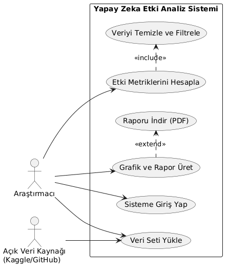
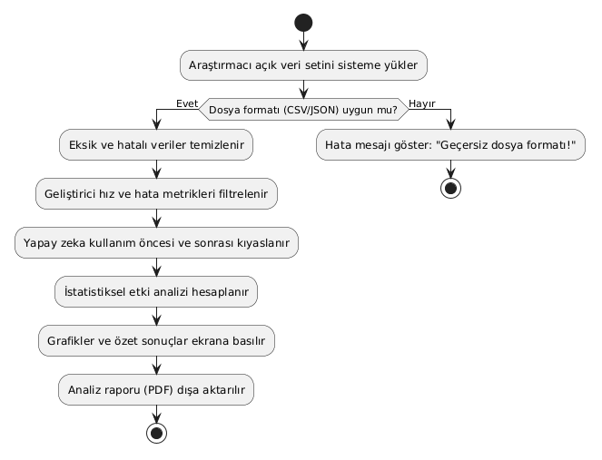
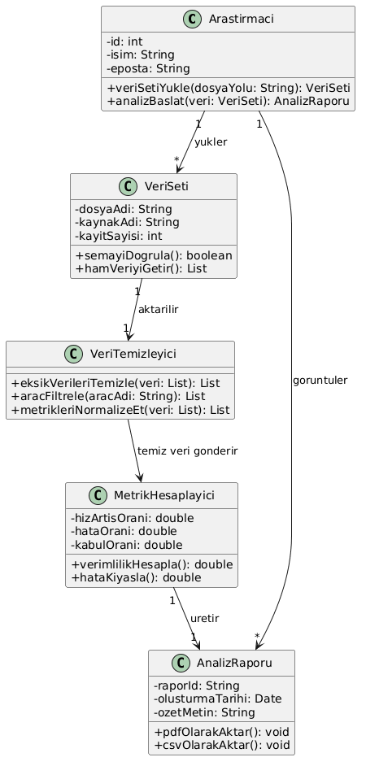

# arastirma-yontemleri-ai-analiz
Yapay Zeka Destekli Kod Asistanlarının Web Geliştirme Süreçlerine Etkisi Araştırma Projesi

## UML Diyagramları

Projenin analitik veri işleme mimarisine ait UML diyagramları:

### 1. Use Case Diagram (Kullanım Durumu)

### 2. Activity Diagram (Etkinlik Akışı)

### 3. Class Diagram (Sınıf Yapısı)

